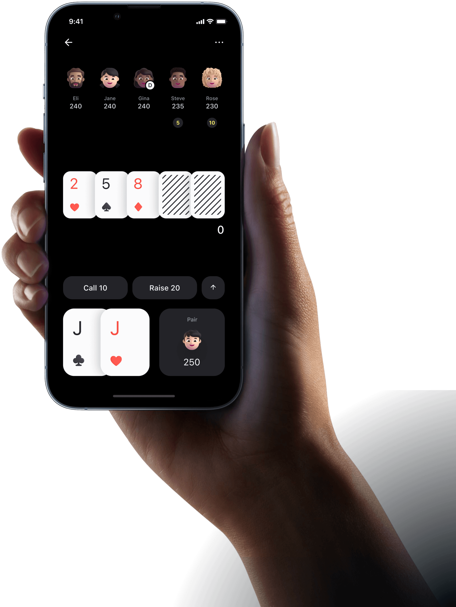
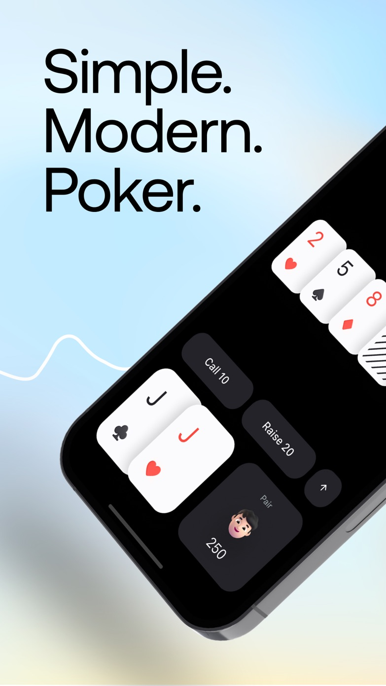
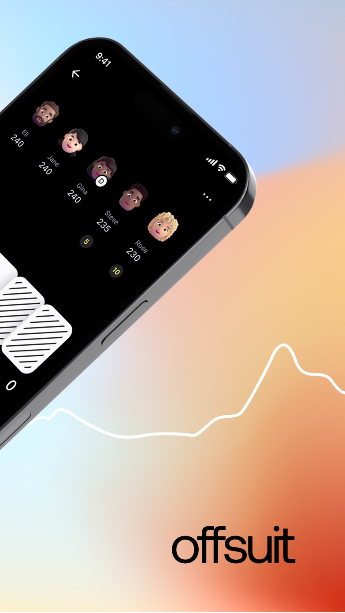
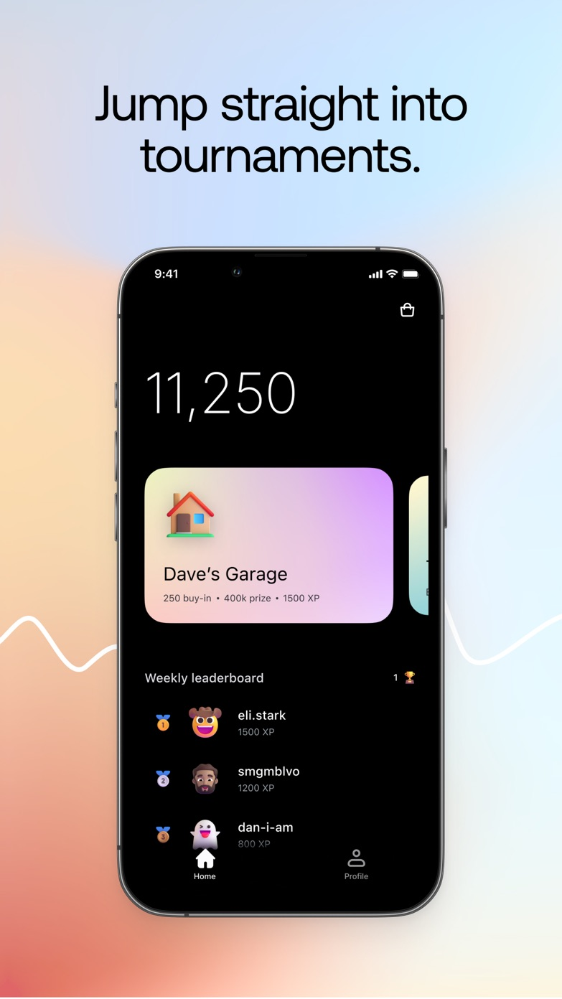
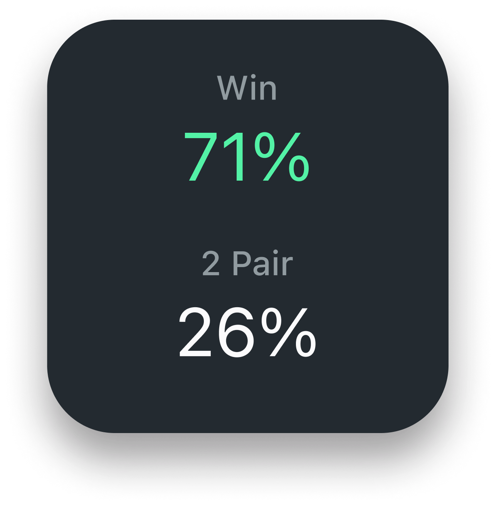
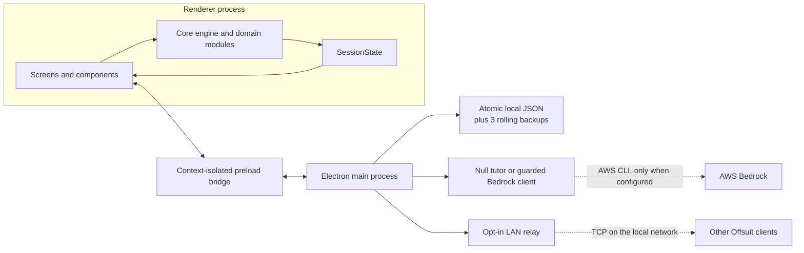

# Offsuit

Offsuit is an Electron + TypeScript desktop Texas Hold'em trainer built around a
playable table. You play real no-limit hands against seeded, rule-based
opponents; a range-aware grader estimates the cost of each decision against a
betting villain's range (not a random hand); and that evidence feeds coaching,
leak detection, drills, assessments, spaced study, and hand review. Gameplay,
grading, written coaching, the equity calculator, the range editor, and the
poker math all run locally with no credentials. Only two features touch the
network, and both are opt-in: an optional AWS Bedrock tutor and a
host-authoritative LAN relay for multiplayer.



## Features

### Play and coaching

- **Playable no-limit Hold'em.** Complete hands against three seeded, rule-based
  opponents drawn from six behavioral archetypes. The engine
  ([`src/core/table.ts`](src/core/table.ts)) handles legal actions, betting
  rounds, all-ins, uncalled chips, side pots, showdown evaluation, and
  settlement. Seeded RNG makes deals and opponent behavior reproducible.
- **Range-aware decision grader.** When facing a bet, hero equity is measured
  against a modelled villain betting range via `equityVsRange`
  ([`src/core/equity.ts`](src/core/equity.ts)), not against two random cards — a
  betting range is strictly stronger than random, so vs-random overstated hero
  equity in exactly the graded spots. The grader emits a severity, an estimated
  EV loss in big blinds, and a named principle ([`src/core/coach.ts`](src/core/coach.ts)).
- **Commit-before-feedback coaching.** In coached mode Offsuit asks for an
  outcome prediction and a confidence level before revealing feedback; a notable
  or serious mistake can require a one-line self-explanation before the verdict
  appears.
- **Leak detection and calibration.** Recorded decisions aggregate into
  VPIP/PFR, per-concept leak summaries, and prediction calibration.

### Study and practice

- **Curriculum.** 24 authored, validated lessons across rules, perception,
  arithmetic, and strategy principles ([`src/core/lessons/`](src/core/lessons/)).
  No lesson is locked.
- **Drills.** Scenario spots, poker math, hand reading, board reading, anomaly
  recognition, stress tests, leak repair, and spaced upkeep.
- **Assessment blocks.** A 30-hand block runs on the same table engine and
  grader as solo play, with feedback withheld until the block ends.
- **Spaced and interleaved study.** Decay/half-life scheduling
  ([`src/core/schedule.ts`](src/core/schedule.ts)), mastery and fading drills,
  and interleaved blocks ([`src/core/interleave.ts`](src/core/interleave.ts)).
- **Reach-weighted prioritization.** The Home recommendation ranks your leaks by
  reach-weighted EV loss (mean ΔEV × reach × 100 against a frozen reference
  population, [`src/core/rw.ts`](src/core/rw.ts)) so the app points you at the
  leak that costs the most across the hands you actually play.
- **Session planner.** Pick a duration and mode and the planner assembles a
  proposed block mix ([`src/core/sessionPlan.ts`](src/core/sessionPlan.ts)).
  Starting a planned session launches a solo table bounded to the plan's live-hand
  count (see Status for the current limit).

### Tools

- **Standalone equity calculator.** A dedicated screen (Equity tab) over the
  verified equity engine: pick a hero hand, an optional board, and an optional
  villain (a specific hand, a range of combos, or "any two") and see win/tie/lose
  and category chances. It adds no poker math of its own — a specific hand routes
  to exact heads-up enumeration (`exactEquityHeadsUp`), a range to combo-weighted
  Monte Carlo (`equityVsRange`), and "any two" to `equityVsRandom`.
- **Preflop charts.** A 13×13 grid with RFI/defense/3-bet views, built from the
  canonical position ranges in [`src/core/preflop.ts`](src/core/preflop.ts).
- **Preflop range editor and trainer.** Paint a 13×13 range on the same 169
  cells, name it, save it to your profile, load it back, and drill against your
  own saved range ([`src/core/rangeEditor.ts`](src/core/rangeEditor.ts)).
- **Correct poker math.** Exact heads-up equity, pot odds, MDF/defence, SPR,
  combo counting, and a normal-CDF risk-of-ruin / variance model, all in
  [`src/core/arithmetic.ts`](src/core/arithmetic.ts) and covered by tests.

### Progress, review, and multiplayer

- **Local-first progress.** Bankroll and hand records persist to a local JSON
  profile with atomic writes and three rolling backups
  ([`src/main/store.ts`](src/main/store.ts), [`src/core/backup.ts`](src/core/backup.ts)).
- **Hand review.** Per-decision replay of a completed hand, storing the board,
  pot, price, action, sizing, verdict, and explanation attempts.
- **LAN multiplayer relay.** Opt-in, host-authoritative tables for 2–6 players on
  a trusted local network. The host owns room state, validates turn ownership and
  action legality, and sends each participant a redacted `RoomView` with
  per-player card redaction ([`src/core/multiplayer.ts`](src/core/multiplayer.ts),
  [`src/main/relayHost.ts`](src/main/relayHost.ts)).
- **Optional Bedrock tutor.** A fixed local answer table by default; when
  configured with AWS credentials it can call Bedrock through phase/mute gates and
  mechanical output guards ([`src/main/tutor/`](src/main/tutor/)).

## Screenshots

The images below are product/landing captures of the built application. Live
visual-regression and audit artifacts live in [`screenshots/`](screenshots/).










## Architecture

The domain code is intentionally independent of Electron. `src/core` holds the
poker and teaching logic; the renderer composes those modules into screens; the
main process owns privileged I/O (disk, speech, the tutor bridge, and the relay).



The renderer runs with context isolation and without Node integration, and its
Electron session allows local schemes only. The two deliberate network paths sit
outside that session layer: the optional tutor invokes Bedrock through an
authenticated AWS CLI process, and multiplayer uses Node TCP sockets after the
user enables it.

### Layers and key boundaries

| Path | Responsibility |
| --- | --- |
| [`src/core/table.ts`](src/core/table.ts) | Table state machine, action validation, street progression, and settlement |
| [`src/core/evaluate.ts`](src/core/evaluate.ts), [`src/core/equity.ts`](src/core/equity.ts) | Hand evaluation, exact heads-up equity, Monte Carlo equity vs random, and equity vs a range |
| [`src/core/coach.ts`](src/core/coach.ts) | Range-aware decision grading and estimated EV-loss messages |
| [`src/core/arithmetic.ts`](src/core/arithmetic.ts) | Pot odds, MDF/defence, SPR, combos, and variance/risk math |
| [`src/core/preflop.ts`](src/core/preflop.ts), [`src/core/rangeEditor.ts`](src/core/rangeEditor.ts) | Canonical position ranges, the villain betting range, and the editable saved-range model |
| [`src/core/session.ts`](src/core/session.ts) | Persisted profile schema, migration defaults, bounded logs, and aggregate counters |
| [`src/core/sessionPlan.ts`](src/core/sessionPlan.ts), [`src/core/interleave.ts`](src/core/interleave.ts), [`src/core/schedule.ts`](src/core/schedule.ts), [`src/core/rw.ts`](src/core/rw.ts) | Session planning, interleaving, spaced scheduling, and reach-weighted study selection |
| [`src/core/lessons/`](src/core/lessons/) | Typed, validated lesson registry and authored content |
| [`src/core/multiplayer.ts`](src/core/multiplayer.ts) | Pure room reducer, turn checks, and recipient-specific state redaction |
| [`src/renderer/main.ts`](src/renderer/main.ts) | UI composition, navigation, and session orchestration |
| [`src/main/preload.ts`](src/main/preload.ts) | Narrow IPC surface exposed through `contextBridge` |
| [`src/main/main.ts`](src/main/main.ts) | Window lifecycle, IPC handlers, network policy, speech, tutor, and relay lifecycle |
| [`src/main/store.ts`](src/main/store.ts), [`src/core/backup.ts`](src/core/backup.ts) | Atomic profile writes, three-version recovery, settings, and confirmed deletion |
| [`src/main/tutor/`](src/main/tutor/) | Request shaping, phase/mute rules, fixed fallback, Bedrock bridge, and output guards |

### Repository layout

```text
src/core/       Poker engine, coaching, curriculum, progress, tools, and pure relay logic
src/main/       Electron entry point, preload, storage, tutor, speech, and networking
src/renderer/   Application composition, screens, components, sound, and styles
tests/unit/     Vitest coverage for domain and main-process modules
tests/e2e/      Serialized Playwright coverage against Electron
scripts/        Audit probes, experiments, and affected-test tooling
demo/           Static design explorations; not part of the runtime application
research/       Product and pedagogy research; not proof of implemented behavior
screenshots/    Visual regression and audit artifacts
```

`PRODUCT-SPEC.md`, `SPEC.md`, and the superseded product spec carry design
history. This README treats source and executable tests as the implementation
record.

## Tech stack

| Technology | Role |
| --- | --- |
| Electron 33 | Desktop shell; separates the unprivileged UI from privileged local I/O |
| TypeScript 5 (strict) | Types across engine state, persisted data, IPC contracts, and UI code |
| Vite 6 | Renderer development and production bundling |
| Vanilla DOM + CSS | Direct control over keyboard behavior, screen lifecycle, and compact table layouts, with no UI framework |
| Vitest | Fast tests for pure engine, teaching, persistence, tutor, and relay logic |
| Playwright | End-to-end tests against the built Electron application |
| Node built-ins | Filesystem persistence, local speech, child processes, and TCP relay transport |

There are no declared runtime dependencies. The application and its build/test
tools come from `devDependencies` and are bundled or launched by the repository
scripts.

## Getting started

The repository does not pin a Node version. Use a current Node.js LTS release
with npm.

```bash
npm ci
npm start
```

`npm start` builds the main process, preload, and renderer, then launches
Electron. Profile data is stored under Electron's per-user application data
directory as `offsuit-state.json`; the Settings screen shows the resolved path
and backup status.

For a quick renderer-only preview:

```bash
npm run dev
```

Vite prints a local URL and keeps state in memory. This mode does not provide
Electron persistence, local speech, the tutor bridge, or network multiplayer.

### Optional Bedrock tutor

The local fixed-answer tutor is used unless all three variables are present:

```bash
OFFSUIT_BEDROCK_PROFILE=<aws-profile> \
OFFSUIT_BEDROCK_REGION=<region> \
OFFSUIT_BEDROCK_MODEL=<model-id> \
npm start
```

This is a developer integration: it needs an authenticated AWS CLI profile and a
Bedrock model compatible with the request format in
[`src/main/tutor/bedrock.ts`](src/main/tutor/bedrock.ts). Model output is retried
once on failure or guard rejection, then falls back to the checked-in answer
table. Settings shows whether the tutor is live, its resolved host allowlist, and
recent guard failures.

## Testing and verification

| Command | Purpose |
| --- | --- |
| `npm run typecheck` | Strict TypeScript check without emitting files |
| `npm test` | Run the Vitest unit suite once |
| `npm run test:watch` | Run Vitest in watch mode |
| `npm run build` | Compile main/preload and bundle the renderer |
| `npm run e2e` | Build, then run Playwright's serialized Electron suite |
| `npx vitest run tests/unit/perf.test.ts` | Run the documented engine performance gates |

The checked-in suite includes 83 Vitest unit files and 59 Playwright E2E specs.
It covers betting legality, chip conservation, all-ins and side pots,
deterministic deals, the range-aware grader and an equity cross-check, the equity
calculator and range editor, corrupt-profile recovery, tutor payload and output
guards, multiplayer redaction, keyboard and screen-reader behavior,
minimum-window layouts, soak flows, and performance budgets.

E2E launches use fixed seeds and isolated user-data directories. Network coverage
includes a loopback proxy with a positive control, so the no-network test
demonstrates that its external oracle can observe an escaped request. Playwright
retains traces and screenshots on failure. Performance baselines and the
self-scaling regression gates are documented in [`BENCHMARKS.md`](BENCHMARKS.md).

There is no checked-in CI workflow; these commands are the local verification
entry points.

## Status and roadmap

- **The coach is a heuristic grader, not a solver.** It uses seeded
  2,000-iteration equity estimates (vs a fixed villain betting range when facing a
  bet, vs random otherwise) plus documented decision heuristics. The villain
  betting range is a single fixed model with no position or board input. EV-loss
  output is teaching feedback, not a GTO solution.
- **Session planner is partially orchestrated.** Starting a planned session bounds
  the solo table to the plan's live-hand count, but it does not yet mount each
  non-play block (drills, review) in sequence.
- **Progress deliberately withholds win-rate and results graphs** because hand
  records do not store all-in-adjusted EV. The reaction-time fluency metric
  renders empty because per-decision latency is not yet recorded.
- **Multiplayer is for trusted local networks.** The host binds all IPv4
  interfaces, so firewall and routing determine actual exposure. It has no
  matchmaking, authentication, encryption, coaching, or multiplayer hand-history
  persistence.
- **The Bedrock tutor is built but needs live keys.** It is a developer
  integration through the AWS CLI, not a packaged credential or account flow, and
  falls back to fixed local answers when not configured.
- **Spoken verdicts use macOS `/usr/bin/say` by default.** The visual verdict
  stays available when speech is unsupported or disabled.
- **No release packaging yet.** The repository has build and launch scripts but no
  installer, signing, or release workflow.
</content>
</invoke>
